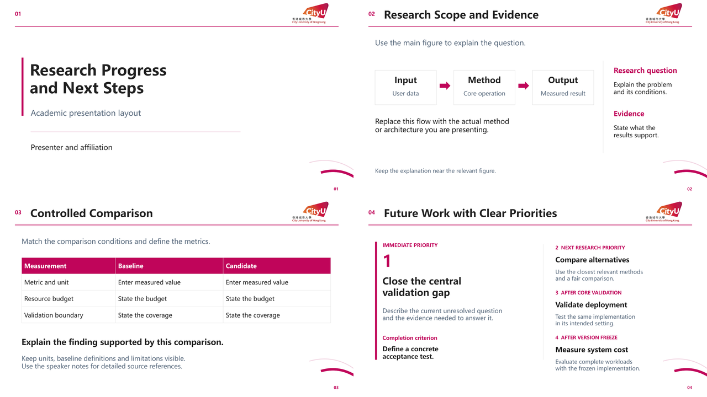

# CityUHK Presentation Skill

Reusable academic presentation skill / 城大风格学术演示文稿技能。

**[下载技能 ZIP（v1.0.0）](https://github.com/caomingqi404-bit/cityu-presentation-style/releases/download/v1.0.0/cityu-presentation-style-v1.0.0.zip)** · [版本发布页](https://github.com/caomingqi404-bit/cityu-presentation-style/releases/latest)



解压后按下方说明安装，调用 `$cityu-presentation-style`。包内附四页可编辑 PowerPoint 示例；支持中文和英文内容。此为个人整理的风格包，非学校官方模板。

---
# 城大风格 PPT 技能分享包

版本：1.0.0

这是一个可手动安装的 `SKILL.md` 技能文件夹。它提供香港城市大学风格的
配色、标识、版式规范、预览和可编辑参考 PPT，适合学术报告、组会和课题汇报。
它不包含个人简历、私人仓库截图或具体项目实验数据。

## 包内内容

```text
cityu-presentation-style/
  SKILL.md
  agents/openai.yaml
  references/style-guide.md
  references/layout-recipes.md
  assets/cityu-logo.png
  assets/cityu-wave.svg
  assets/cityu-wave.png
  assets/cityu-starter.pptx
  assets/preview.png
  ASSET_NOTICES.md
  MANIFEST.sha256
  README.md
```

## 接收者怎么安装

1. 解压 ZIP，找到整个 `cityu-presentation-style` 文件夹。
2. 将整个文件夹放入自己工具的技能目录，保留其中的 `assets` 和 `references`。
3. 在工具中选择或明确调用该技能。

按照当前 [OpenAI 官方技能文档](https://learn.chatgpt.com/docs/build-skills)，
Codex 的个人技能目录为 `~/.agents/skills/`，项目技能目录为
`项目目录/.agents/skills/`。

Windows 个人目录示例：

```text
%USERPROFILE%\.agents\skills\cityu-presentation-style\SKILL.md
```

macOS / Linux 个人目录示例：

```text
~/.agents/skills/cityu-presentation-style/SKILL.md
```

如果目标目录已有同名技能，先保留旧版，再决定替换。不要只复制 `SKILL.md`。
如果技能未显示，刷新技能列表或重启应用。其他支持 `SKILL.md` 的工具，按该
工具自己的技能安装方式放置；本包不承诺所有产品都支持相同的安装界面。

## 怎么使用

例如向助手发送：

```text
使用 $cityu-presentation-style，根据我提供的大纲制作一份全英文组会汇报。
保持白底、洋红色标题线、右上角城大标识和右下角浅色曲线。
请突出主要研究发现，图表和文字可编辑，完成后逐页检查。
```

也可以让助手重排已有 PPT：

```text
使用 $cityu-presentation-style 将这份 PPT 调整为城大风格。
保留现有页数和内容顺序，正文采用中文，下一步计划需要明确主次。
```

不使用 AI 工具时，也可直接打开 `assets/cityu-starter.pptx`，复制所需页面并
替换内容。四页分别演示封面、图示与说明、对照表、具有主次关系的未来工作。

## 环境要求

技能本身不需要 API Key、账号令牌、联网脚本或后台服务。生成新幻灯片需要接收者
环境已有可用的演示文稿工具；本包不附带 PowerPoint、字体文件或整套运行时。
如果工具提供自己的演示文稿技能，应同时遵循其导出和渲染要求。

样例使用 Microsoft YaHei。若本机没有该字体，选择支持所需语言的本地字体后
检查换行和溢出。中文和英文均可使用，不会强制加入姓名、日期或研究组名。

`MANIFEST.sha256` 可用于核对包内文件是否一致。本次发布核查覆盖技能结构、
相对资源链接、示例 PPTX 结构和四页渲染；不同操作系统与其他 AI 产品仍需自行验证。

标识和素材说明见 [ASSET_NOTICES.md](ASSET_NOTICES.md)。
